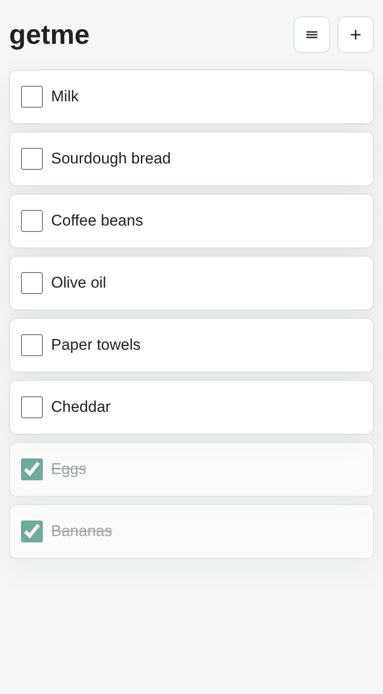

<p align="center">
  
</p>

<h1 align="center">getme</h1>

<p align="center">
  A dead-simple, self-hosted list app. One PHP app, one SQLite file, no accounts.
</p>

<p align="center">
  <a href="https://github.com/tylxr59/getme/actions/workflows/ci.yml"></a>
  <a href="https://github.com/tylxr59/getme/releases/latest"></a>
  <a href="#-requirements"></a>
  <a href="LICENSE"></a>
</p>

<p align="center">
  <a href="#-features">Features</a> ·
  <a href="#-quick-start">Quick start</a> ·
  <a href="#-api">API</a> ·
  <a href="#-security">Security</a>
</p>

---

## 🛒 getme

getme is a dead-simple, self-hosted list app: a small PHP backend and one SQLite database. Anyone with the URL can use it.

Because sometimes you just need a list that:

- Works on any device with a browser
- Doesn't require an account
- Doesn't track you
- Runs on practically anything with PHP

<p align="center">
  <picture>
    <source media="(prefers-color-scheme: dark)" srcset="assets/screenshot-dark.png">
    
  </picture>
</p>

> [!TIP]
> Take your list to your wrist with [getme for Pebble](https://github.com/tylxr59/getme-for-pebble), the Pebble Time 2 companion app.

## 🎯 Features

|                         |                                                                                                           |
| ----------------------- | --------------------------------------------------------------------------------------------------------- |
| ✏️ **Quick editing**    | Add, edit, and delete items. Press Enter while editing to save and start the next one.                    |
| ✅ **Check off items**  | Checked items move to the bottom.                                                                         |
| ↕️ **Drag to reorder**  | Works with a mouse or touch.                                                                              |
| 🌗 **Dark mode**        | Follows your system theme.                                                                                |
| 🔄 **Always current**   | Refreshes when you return to the tab.                                                                     |
| 📋 **Copy as Markdown** | Paste your list anywhere.                                                                                 |
| 🔌 **Open JSON API**    | Integrate other apps, scripts, or automations.                                                            |
| ⌚ **Pebble app**       | Check and add items from your wrist with [getme for Pebble](https://github.com/tylxr59/getme-for-pebble). |

## 📋 Requirements

- PHP 7.4+ with PDO SQLite extension
- A web server (Apache, Nginx, etc.)

## 🚀 Quick start

1. Download the latest `getme-<version>.zip` from [GitHub Releases](https://github.com/tylxr59/getme/releases/latest), or clone this repo (**Code → Download ZIP** works too).
2. Upload `index.php`, `server/`, and `web/` together to a PHP-enabled web server
3. Make sure the directory is writable (for the SQLite database)
4. Open it in your browser

The SQLite database (`getme.db`) is created automatically on first run.

To rename the list, edit `$listName` near the top of `index.php`. To move the database outside the web directory, set `GETME_DATABASE` or edit `$databasePath`.

## 🔌 API

External apps can use the same URL as the web app as a JSON API. The API is unauthenticated; anyone who can reach the URL can read and change the list.

getme for Pebble uses this API to fetch the list, add items, toggle checked state, and clear checked items.

All requests are `POST` with `Content-Type: application/json`. CORS preflight requests are supported for browser-like clients.

Fetch the current list:

```bash
curl -X POST https://your-server/getme/ \
  -H "Content-Type: application/json" \
  -d '{"action": "fetch"}'
```

Response:

```json
{
  "success": true,
  "items": [{ "id": 1, "name": "Milk", "checked": 0, "position": 1 }]
}
```

Add an item. The older `add_item` action is still accepted as an alias for `add`.

Clients may include a unique `request_id` with an add request. Retrying with the same ID returns the original item, which helps when a slow connection drops the response after the item was saved.

```bash
curl -X POST https://your-server/getme/ \
  -H "Content-Type: application/json" \
  -d '{"action": "add", "name": "Milk", "request_id": "example-unique-id"}'
```

Edit an item:

```bash
curl -X POST https://your-server/getme/ \
  -H "Content-Type: application/json" \
  -d '{"action": "edit", "id": 1, "name": "Oat milk"}'
```

Toggle an item:

```bash
curl -X POST https://your-server/getme/ \
  -H "Content-Type: application/json" \
  -d '{"action": "toggle", "id": 1, "checked": 1}'
```

Reorder items:

```bash
curl -X POST https://your-server/getme/ \
  -H "Content-Type: application/json" \
  -d '{"action": "reorder", "items": [2, 1, 3]}'
```

Delete an item:

```bash
curl -X POST https://your-server/getme/ \
  -H "Content-Type: application/json" \
  -d '{"action": "delete", "id": 1}'
```

Clear checked items:

```bash
curl -X POST https://your-server/getme/ \
  -H "Content-Type: application/json" \
  -d '{"action": "clear_checked"}'
```

Clear all items:

```bash
curl -X POST https://your-server/getme/ \
  -H "Content-Type: application/json" \
  -d '{"action": "clear_all"}'
```

## 🔐 Security

This is intentionally unauthenticated. Anyone who can reach the URL can add, edit, reorder, check, and delete items.

If you leave the default database path in place, configure your web server not to serve `getme.db` directly. A safer option is to set `$databasePath` to a location outside the web root.

## 🩺 Troubleshooting

| Symptom                                               | Fix                                                                                                                                                       |
| ----------------------------------------------------- | --------------------------------------------------------------------------------------------------------------------------------------------------------- |
| Errors on first load, or changes don't save           | PHP needs write access to the directory holding `getme.db` (or the `GETME_DATABASE` path).                                                                |
| `getme.db` can be downloaded from the web             | Block it in your web server config, or move the database outside the web root. See [Security](#-security).                                                |
| A page is missing styles or features after an upgrade | Upload `index.php`, `server/`, and `web/` together so they match.                                                                                         |
| getme for Pebble can't connect                        | Check the URL loads from your phone's browser, then see the [Pebble app's troubleshooting](https://github.com/tylxr59/getme-for-pebble#-troubleshooting). |

## 👋 Development

The API, list service, web client state, and presentation live in separate modules.
See [architecture and migration](docs/architecture.md) and the [versioned sync API](docs/api.md).
The versioned API provides atomic batches, revision conflict detection, and durable
operation deduplication. Existing unversioned clients remain supported.

To run it locally:

```bash
php -S 127.0.0.1:8000
```

Run checks with PHP CLI (PDO SQLite), Node, and Python:

```bash
php tests/api.php
node --test tests/web.test.js
python3 tests/http_integration.py
```

The HTTP test starts a loopback-only PHP server with a temporary database.

CI runs these checks on PHP 7.4 and 8.4 for every push and pull request. Bug reports and contributions are welcome through [GitHub Issues](https://github.com/tylxr59/getme/issues).

## 📦 Releases

Push a `v<version>` tag. The [release workflow](.github/workflows/release.yml) runs the tests, packages `index.php`, `server/`, `web/`, and the license as `getme-<version>.zip`, and publishes it to [GitHub Releases](https://github.com/tylxr59/getme/releases) with generated release notes.

## 📃 License

getme is available under the [MIT License](LICENSE).
